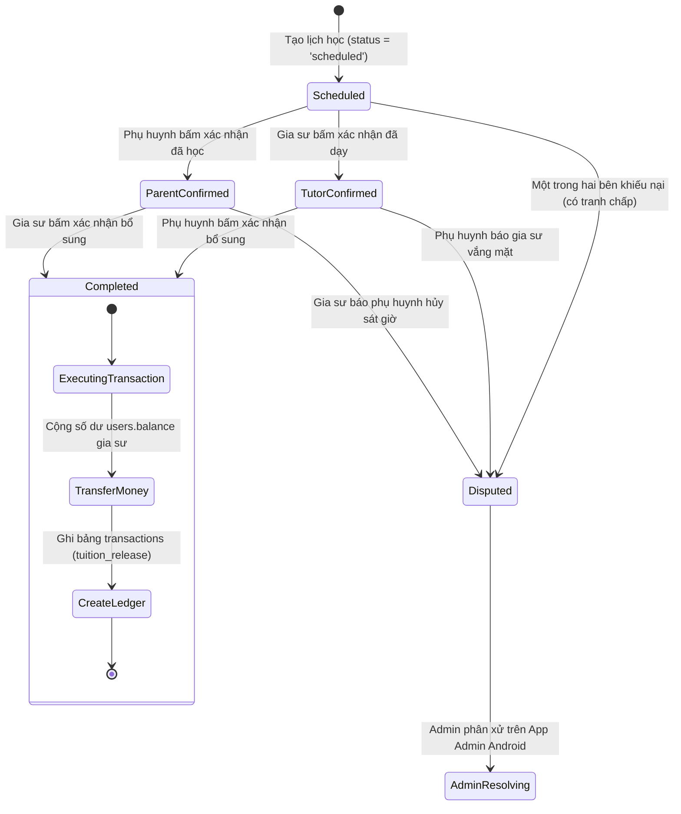
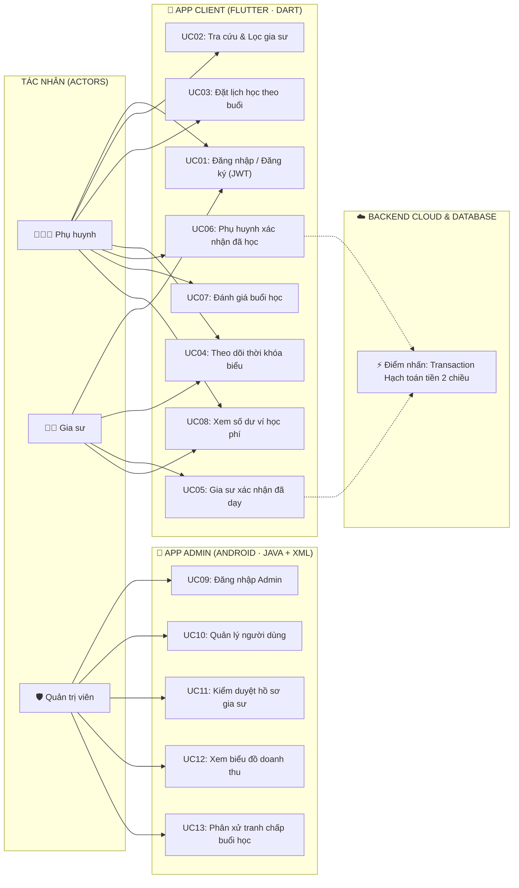
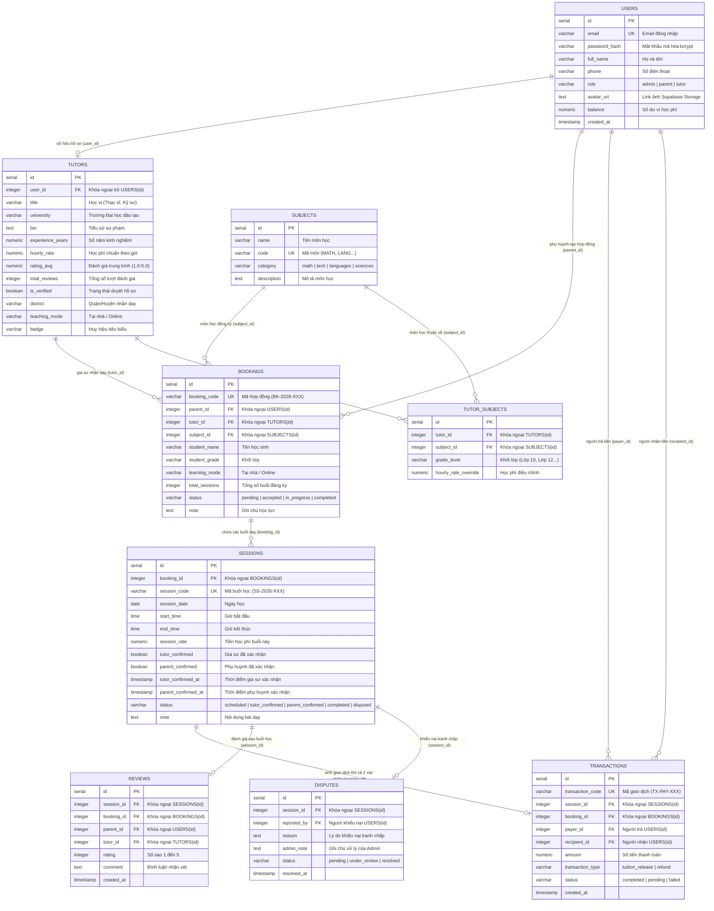

# BÁO CÁO ĐỒ ÁN CUỐI KỲ: INT4211 · LẬP TRÌNH TRÊN CÁC THIẾT BỊ DI ĐỘNG
## ĐỀ TÀI SỐ 22: NỀN TẢNG KẾT NỐI GIA SƯ VÀ PHỤ HUYNH (EDUCONNECT)

* **Học phần:** INT4211 · Lập trình trên các thiết bị di động (HK261 — [VHU-261] LTDD)
* **Đơn vị đào tạo:** Khoa Công nghệ Thông tin — Trường Đại học Văn Hiến (VHU)
* **Kho lưu trữ GitHub:** [https://github.com/vuongskyy-sys/androistudio](https://github.com/vuongskyy-sys/androistudio)
* **Mô hình kiến trúc:** **HỆ THỐNG ĐA NỀN TẢNG DÙNG CHUNG 1 CƠ SỞ DỮ LIỆU**
  1. 📱 **App Admin:** Android Native (Java + XML · minSdk 24 · Retrofit 2 + Gson) — Dành cho Quản trị viên
  2. 📱 **App Client:** Flutter 3.35+ (Dart 3) — Dành cho Khách hàng (Phụ huynh & Gia sư)
  3. ☁️ **Backend Cloud:** Node.js 20 + Express 4 + `pg` (REST API + JWT + bcrypt) — Deploy trên Render
  4. 🗄️ **Cơ sở dữ liệu:** PostgreSQL trên Supabase (Connection Pooler cổng 5432 · **9 bảng có khóa ngoại**)
* **Điểm nhấn kỹ thuật cốt lõi (Đề 22):**
  > **"Xác nhận hai chiều cho mỗi buổi dạy: Một buổi chỉ được tính (và tính tiền) khi cả gia sư lẫn phụ huynh đều xác nhận hoàn thành buổi học."**

---

## MỤC LỤC
1. [Bảng Phân Công Nhiệm Vụ 4 Thành Viên](#1-bảng-phân-công-nhiệm-vụ-4-thành-viên)
2. [Điểm Nhấn Kỹ Thuật Đề 22: Luồng Xác Nhận Hai Chiều & Transaction](#2-điểm-nhấn-kỹ-thuật-đề-22-luồng-xác-nhận-hai-chiều--transaction)
3. [Sơ Đồ Use Case Toàn Hệ Thống](#3-sơ-đồ-use-case-toàn-hệ-thống)
   - 3.1. Danh sách Tác nhân & Phân quyền trên 2 App
   - 3.2. Sơ đồ Use Case tổng quát (Mermaid)
   - 3.3. Đặc tả kịch bản Use Case trọng tâm: Xác nhận hai chiều buổi học
4. [Sơ Đồ Cơ Sở Dữ Liệu PostgreSQL (9 Bảng Có Khóa Ngoại)](#4-sơ-đồ-cơ-sở-dữ-liệu-postgresql-9-bảng-có-khóa-ngoại)
   - 4.1. Sơ đồ thực thể liên kết ERD (Mermaid)
   - 4.2. Bảng đặc tả chi tiết 9 bảng CSDL
   - 4.3. Ràng buộc toàn vẹn & Kịch bản Database Transaction tính tiền
5. [Kiến Trúc Thư Mục & Stack Công Nghệ Hệ Thống](#5-kiến-trúc-thư-mục--stack-công-nghệ-hệ-thống)
6. [Hướng Dẫn Cài Đặt & Triển Khai (Deployment Guide)](#6-hướng-dẫn-cài-đặt--triển-khai-deployment-guide)

---

## 1. BẢNG PHÂN CÔNG NHIỆM VỤ 4 THÀNH VIÊN

> [!IMPORTANT]
> Dự án được xây dựng theo đúng cấu trúc **Một Hệ Thống Đa Nền Tảng (Admin Android + Client Flutter + Backend Cloud + PostgreSQL)**. Bảng phân công phản ánh đúng 4 trụ cột kỹ thuật của đề cương môn học, mỗi thành viên đóng góp 25% tỷ lệ công việc.

| STT | Họ và Tên Sinh Viên | Mã Số Sinh Viên (MSSV) | Trụ Cột Đảm Nhiệm Chính | Nội Dung Công Việc Kỹ Thuật Cụ Thể | Tỷ Lệ Đóng Góp | Đánh Giá |
|:---:|:---|:---:|:---|:---|:---:|:---:|
| **1** | **Lê Thị Trúc Giang** | `221A310077` | **Nhóm trưởng**<br>📱 *App Client Lead (Flutter)* | • Quản lý tổng thể tiến độ đồ án, phân chia mốc nộp Tuần 8 → Tuần 15.<br>• Lập trình **App Client Flutter (Dart 3 · Flutter 3.35+)** cho Phụ huynh & Gia sư: `client_flutter/`.<br>• Xây dựng màn hình Lịch học với **nút Xác nhận buổi học hai chiều**, thanh SnackBar có nút HOÀN TÁC.<br>• Thiết kế giao diện Material 3, Drawer/NavigationBar, form validator và quản lý Token JWT trên Client. | **25%** | **100%** |
| **2** | **Lê Công Đức Thiện** | `231A011078` | ☁️ *Backend Cloud & Database Lead* | • Thiết kế CSDL PostgreSQL trên **Supabase** với **9 bảng có khóa ngoại** (`backend/schema.sql`).<br>• Lập trình **Backend REST API (Node.js 20 + Express 4 + pg)**: `backend/src/server.js`.<br>• Lập trình **Nghiệp vụ Transaction Xác nhận hai chiều (`POST /api/sessions/:id/confirm`)**: sử dụng `BEGIN ... COMMIT ... ROLLBACK` tự động giải ngân học phí và chuyển trạng thái khi cả hai bên xác nhận.<br>• Cấu hình bảo mật JWT, mã hóa bcrypt và triển khai dịch vụ lên **Render Web Service**. | **25%** | **100%** |
| **3** | **Trần Nguyễn Quang Huy** | `231A010954` | 📱 *App Admin Lead (Android)* | • Lập trình **App Admin (Android Studio · Java + XML · minSdk 24)** cho Quản trị viên: `app/`.<br>• Tích hợp thư viện **Retrofit 2 + Gson** kết nối chung CSDL với Backend Render.<br>• Xây dựng RecyclerView quản lý danh sách người dùng, duyệt hồ sơ gia sư kiểm định.<br>• Thiết kế màn hình **Báo cáo thống kê doanh thu và số buổi học có Biểu đồ (Chart)**.<br>• Lập trình phân hệ xử lý tranh chấp buổi học (`disputes`) dành cho Admin. | **25%** | **100%** |
| **4** | **Tống Nhựt Trường** | `241A010305` | ⚙️ *API Integration, Testing & DevOps Lead* | • Tích hợp API giữa Backend Cloud với App Admin Android và App Client Flutter.<br>• Quản trị kho lưu trữ GitHub chung, kiểm soát lịch sử commit (đạt chuẩn ≥ 15 commit/thành viên).<br>• Cấu hình **Supabase Storage** lưu trữ ảnh đại diện (không lưu base64 trong CSDL).<br>• Thực hiện kiểm thử kịch bản End-to-End điểm nhấn Xác nhận hai chiều, đóng gói file APK (`apk/app-debug.apk`) và biên tập video demo. | **25%** | **100%** |

---

## 2. ĐIỂM NHẤN KỸ THUẬT ĐỀ 22: LUỒNG XÁC NHẬN HAI CHIỀU & TRANSACTION

Điểm nhấn kỹ thuật mang tính quyết định của Đề 22 là: **Buổi học chỉ được tính là hoàn thành (và hạch toán tiền) khi CẢ GIA SƯ VÀ PHỤ HUYNH ĐỀU XÁC NHẬN**.



### Quy trình Database Transaction tại Backend (`POST /api/sessions/:id/confirm`):
1. **Khóa dòng dữ liệu (Row-level Locking):** Sử dụng `SELECT ... FOR UPDATE` trên bảng `sessions` để ngăn ngừa Race Condition (chống việc hai bên nhấn cùng 1 micro-giây gây cộng tiền 2 lần).
2. **Cập nhật cờ xác nhận:** 
   - Nếu Gia sư gọi API: `tutor_confirmed = TRUE`, `tutor_confirmed_at = NOW()`.
   - Nếu Phụ huynh gọi API: `parent_confirmed = TRUE`, `parent_confirmed_at = NOW()`.
3. **Kiểm tra điều kiện hạch toán:**
   - Nếu `tutor_confirmed = TRUE AND parent_confirmed = TRUE`:
     * Đổi `sessions.status = 'completed'`.
     * Tự động cộng tiền vào tài khoản gia sư: `UPDATE users SET balance = balance + session_rate WHERE id = tutor_user_id`.
     * Ghi sổ cái kế toán: `INSERT INTO transactions (...) VALUES ('tuition_release', 'completed')`.
     * Thực thi lệnh `COMMIT`.
   - Nếu mới có 1 bên xác nhận: Giữ nguyên số dư, đổi trạng thái sang `tutor_confirmed` hoặc `parent_confirmed`, trả về thông báo chờ đối tác xác nhận.
   - Nếu có bất kỳ lỗi nào xảy ra: Thực thi lệnh `ROLLBACK` bảo toàn toàn vẹn dữ liệu.

---

## 3. SƠ ĐỒ USE CASE TOÀN HỆ THỐNG

### 3.1. Danh Sách Tác Nhân & Phân Quyền
1. **Khách hàng (Dùng App Client Flutter):**
   - **Phụ huynh (Parent):** Tra cứu gia sư, đặt lịch học, xem thời khóa biểu, **Xác nhận buổi học**, đánh giá chất lượng buổi học sau khi hoàn thành.
   - **Gia sư (Tutor):** Xem danh sách lớp nhận dạy, **Xác nhận hoàn thành buổi dạy**, theo dõi số dư ví học phí tích lũy.
2. **Người quản lý (Dùng App Admin Android):**
   - **Quản trị viên (Admin):** Đăng nhập phân quyền Admin, kiểm duyệt hồ sơ bằng cấp gia sư, xem **Báo cáo thống kê biểu đồ doanh thu hệ thống**, giải quyết tranh chấp buổi dạy (`disputes`).

---

### 3.2. Sơ Đồ Use Case Tổng Quát (Mermaid)



---

### 3.3. Bảng Đặc Tả Chi Tiết Use Case Trọng Tâm: Xác Nhận Hai Chiều Buổi Học

| Mục | Nội Dung Đặc Tả Chi Tiết |
|:---|:---|
| **Tên Use Case** | **UC05 / UC06: Xác nhận hai chiều buổi học (Two-way Session Confirmation)** |
| **Tác nhân** | Phụ huynh (Parent) và Gia sư (Tutor) trên App Client Flutter |
| **Tiền điều kiện** | Buổi học đã diễn ra đến khung giờ kết thúc, trạng thái ban đầu là `scheduled`. Cả hai bên đã đăng nhập thành công. |
| **Hậu điều kiện** | Trạng thái buổi học cập nhật thành `completed`. Gia sư được cộng tiền vào ví, giao dịch `tuition_release` được tạo. |
| **Luồng sự kiện chính (Main Flow)** | 1. Gia sư mở App Client -> Tab Lịch học -> Chọn buổi vừa dạy xong -> Nhấn **"Xác nhận đã dạy"**.<br>2. App Client gọi API `POST /api/sessions/:id/confirm` (kèm JWT của Gia sư).<br>3. Backend cập nhật `tutor_confirmed = TRUE`, đổi trạng thái thành `tutor_confirmed`. App Client hiển thị SnackBar: *"Đã ghi nhận, chờ phụ huynh xác nhận"*, có nút **HOÀN TÁC**.<br>4. Phụ huynh mở App Client -> Nhận thấy thông báo buổi học đang chờ duyệt -> Kiểm tra con đã học xong -> Nhấn **"Phụ huynh xác nhận"**.<br>5. App Client gọi API `POST /api/sessions/:id/confirm` (kèm JWT của Phụ huynh).<br>6. Backend kích hoạt **Database Transaction**: nhận thấy cả 2 cờ đều là `TRUE` -> Cập nhật `status = 'completed'` -> Cộng tiền học phí vào ví Gia sư -> Ghi lịch sử giao dịch vào bảng `transactions` -> Thực hiện `COMMIT`.<br>7. Cả hai App Client tải lại giao diện, hiển thị huy hiệu xanh: **"✓ Hoàn thành (Đã giải ngân)"**. |
| **Luồng ngoại lệ (Alternative Flow)** | • Nếu Phụ huynh không đồng ý vì Gia sư vắng mặt: Phụ huynh nhấn **"Báo cáo tranh chấp"** -> Buổi học chuyển sang trạng thái `disputed`, tạo bản ghi trong bảng `disputes` để Quản trị viên xử lý trên App Admin Android. |

---

## 4. SƠ ĐỒ CƠ SỞ DỮ LIỆU POSTGRESQL (9 BẢNG CÓ KHÓA NGOẠI)

Cơ sở dữ liệu được triển khai trên **PostgreSQL (Supabase)**, kết nối thông qua chuỗi Connection Pooler (Session mode, cổng 5432) để tương thích hoàn toàn với nền tảng máy chủ Render.

### 4.1. Sơ Đồ Thực Thể Liên Kết ERD (Mermaid Diagram)



---

### 4.2. Bảng Đặc Tả Chi Tiết 9 Bảng CSDL (PostgreSQL)

| STT | Tên Bảng (Table) | Mục Đích Nghiệp Vụ | Số Cột | Khóa Chính (PK) | Khóa Ngoại (FK) & Ràng Buộc Quan Hệ |
|:---:|:---|:---|:---:|:---:|:---|
| **1** | `users` | Quản lý định danh tài khoản, phân quyền 3 vai trò và số dư ví tiền. | 9 | `id` (SERIAL) | `email` UNIQUE, `role IN ('admin', 'parent', 'tutor')`. |
| **2** | `tutors` | Lưu hồ sơ sư phạm, bằng cấp, học vị, khu vực dạy và học phí chuẩn. | 14 | `id` (SERIAL) | `user_id` -> `users(id)` (Quan hệ 1 - 1). |
| **3** | `subjects` | Danh mục môn học phân theo 4 nhóm (Toán, Công nghệ, Ngôn ngữ, Khoa học). | 5 | `id` (SERIAL) | `code` UNIQUE, `category IN ('math', 'tech', 'languages', 'sciences')`. |
| **4** | `tutor_subjects` | Phân công môn học cho gia sư theo khối lớp cụ thể (Quan hệ N - N). | 5 | `id` (SERIAL) | `tutor_id` -> `tutors(id)`, `subject_id` -> `subjects(id)`. |
| **5** | `bookings` | Hợp đồng đặt khóa học của phụ huynh kèm thông tin học sinh. | 12 | `id` (SERIAL) | `parent_id` -> `users(id)`, `tutor_id` -> `tutors(id)`, `subject_id` -> `subjects(id)`. |
| **6** | `sessions` | **Điểm nhấn đề 22:** Quản lý từng buổi học cụ thể với 2 cờ `tutor_confirmed` và `parent_confirmed`. | 14 | `id` (SERIAL) | `booking_id` -> `bookings(id)`. |
| **7** | `transactions` | Giao dịch tài chính tự động sinh ra khi cả hai bên xác nhận hoàn thành buổi học. | 9 | `id` (SERIAL) | `session_id` -> `sessions(id)`, `payer_id` & `recipient_id` -> `users(id)`. |
| **8** | `reviews` | Đánh giá sao và nhận xét của phụ huynh sau khi buổi học hoàn tất. | 8 | `id` (SERIAL) | `session_id` -> `sessions(id)`, `parent_id` -> `users(id)`, `tutor_id` -> `tutors(id)`. |
| **9** | `disputes` | Lưu các phản ánh tranh chấp (gia sư vắng mặt, học sai giờ) để Admin xử lý trên App Android. | 8 | `id` (SERIAL) | `session_id` -> `sessions(id)`, `reported_by` -> `users(id)`. |

---

## 5. KIẾN TRÚC THƯ MỤC & STACK CÔNG NGHỆ HỆ THỐNG

Dự án được tổ chức theo chuẩn cấu trúc Monorepo thống nhất, bao gồm cả 3 thành phần của đề án:

```
c:\dev\doanAndroi
├── backend/                       // Phân hệ 1: Backend Cloud (Node.js + PostgreSQL)
│   ├── package.json               // dependencies: express, pg, jsonwebtoken, bcrypt, cors
│   ├── schema.sql                 // Định nghĩa 9 bảng CSDL PostgreSQL có khóa ngoại
│   ├── seed.sql                   // Dữ liệu mẫu EduConnect tiếng Việt khởi tạo sẵn
│   ├── .env.example               // Mẫu cấu hình DATABASE_URL (Supabase Pooler 5432) & JWT_SECRET
│   └── src
│       └── server.js              // REST API Server + Transaction xác nhận 2 chiều
│
├── app/                           // Phân hệ 2: App Admin (Android Native · Java + XML)
│   ├── build.gradle.kts           // Cấu hình minSdk 24, Retrofit 2 + Gson, Glide, Material 3
│   └── src/main/java/vn/edu/vhu/ltdd/doanandroi
│       ├── MainActivity.java      // Điều hướng BottomNavigation 4 phân hệ
│       ├── api                    // Tầng kết nối mạng Retrofit 2 gọi Backend Render
│       │   ├── ApiClient.java
│       │   └── ApiService.java
│       ├── database               // SQLite đệm dữ liệu ngoại tuyến
│       │   └── DatabaseHelper.java
│       ├── activities             // LoginActivity, TutorDetailActivity, SplashActivity...
│       ├── fragments              // HomeFragment, TutorsFragment, ScheduleFragment, ProfileFragment
│       └── adapters               // TutorAdapter, BookingAdapter
│
├── client_flutter/                // Phân hệ 3: App Client (Flutter 3.35+ · Dart 3)
│   ├── pubspec.yaml               // dependencies: flutter, http, shared_preferences
│   └── lib
│       ├── main.dart              // Khởi chạy App Client (Material 3, NavigationBar)
│       └── screens
│           └── sessions_screen.dart // Màn hình Lịch học với Nút xác nhận 2 chiều + SnackBar Hoàn tác
│
├── apk/
│   └── app-debug.apk              // Bản dựng APK hoàn chỉnh (7.69 MB) phục vụ chấm điểm ngay
└── README.md                      // Báo cáo thuyết minh đồ án chuẩn mực Tuần 9
```

---

## 6. HƯỚNG DẪN CÀI ĐẶT & TRIỂN KHAI (DEPLOYMENT GUIDE)

### 6.1. Triển Khai Backend Lên Render & CSDL Supabase (Theo Chuẩn Slide Bẫy Hạ Tầng)
1. **Khởi tạo CSDL trên Supabase:**
   - Tạo Project mới trên [Supabase](https://supabase.com/).
   - Mở mục **SQL Editor** -> Dán toàn bộ nội dung file [`backend/schema.sql`](file:///c:/dev/doanAndroi/backend/schema.sql) và bấm **Run**.
   - Dán tiếp nội dung file [`backend/seed.sql`](file:///c:/dev/doanAndroi/backend/seed.sql) và bấm **Run** để nạp dữ liệu mẫu.
   - Vào **Project Settings** -> **Database** -> **Connection string** -> Chọn tab **Connection pooler**, chế độ **Session mode**, cổng **5432** để lấy chuỗi `DATABASE_URL` (tránh lỗi IPv6 trên Render).
2. **Triển khai Web Service trên Render:**
   - Đăng nhập [Render](https://render.com/) -> Chọn **New Web Service** -> Kết nối repo GitHub `https://github.com/vuongskyy-sys/androistudio`.
   - **Root Directory:** `backend`
   - **Build Command:** `npm install`
   - **Start Command:** `node src/server.js`
   - **Environment Variables:**
     * `DATABASE_URL`: *(Dán chuỗi Supabase pooler cổng 5432)*
     * `JWT_SECRET`: `educonnect_super_secret_jwt_key_2026_int4211`

### 6.2. Chạy App Admin Android Trên Android Studio
1. Mở Android Studio -> Chọn **Open** -> Điều hướng tới thư mục `c:\dev\doanAndroi`.
2. Gradle Sync tự động tải các thư viện Retrofit 2, Gson và Material Components.
3. Bấm **Run 'app'** (`Shift + F10`) để chạy lên máy ảo.
4. Đăng nhập nhanh tài khoản Admin: `admin@educonnect.vn` / Mật khẩu `123456`.

### 6.3. Chạy App Client Flutter
1. Mở cửa sổ dòng lệnh tại thư mục `client_flutter`:
   ```bash
   cd c:\dev\doanAndroi\client_flutter
   flutter pub get
   flutter run
   ```
2. Thử nghiệm ngay luồng **Xác nhận hai chiều**: Bấm xác nhận trên App Client và quan sát giao dịch giải ngân học phí tức thì!
