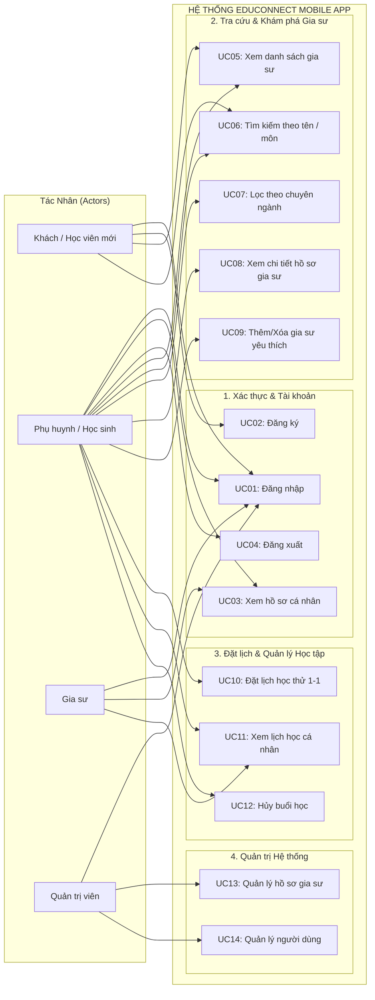
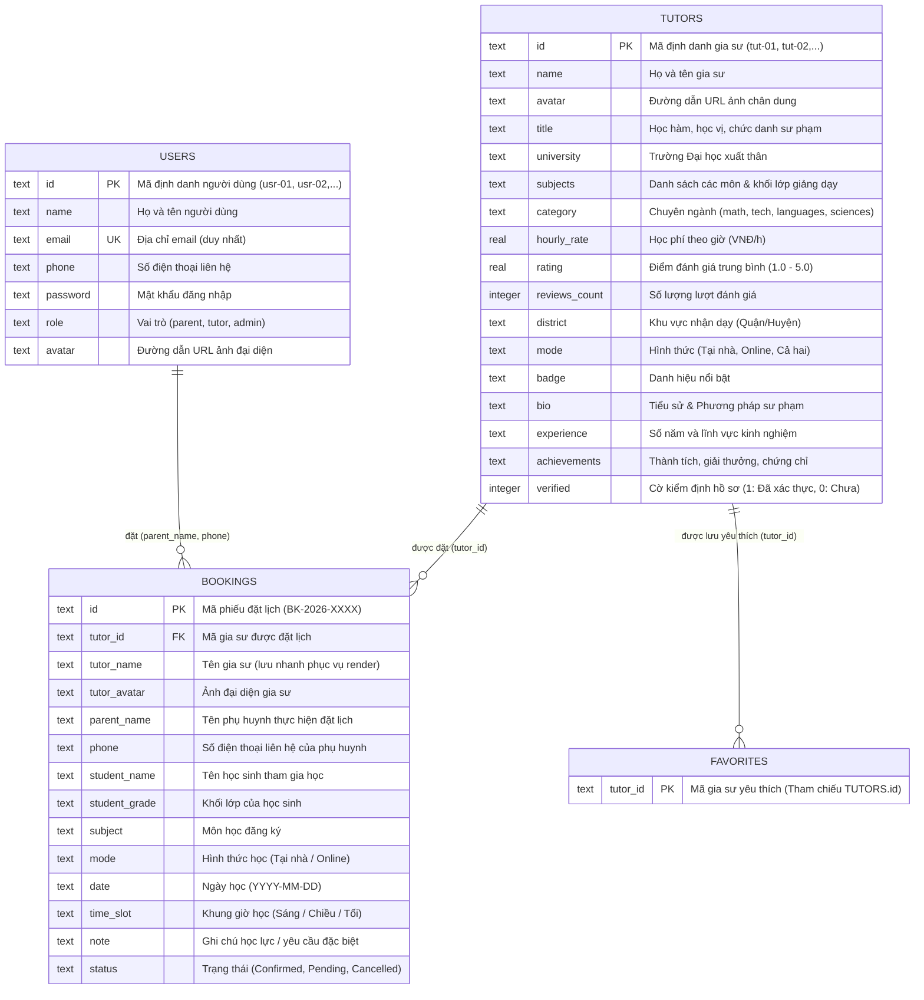

# BÁO CÁO ĐỒ ÁN MÔN HỌC: LẬP TRÌNH DI ĐỘNG (ANDROID)
## ĐỀ TÀI: ỨNG DỤNG EDUCONNECT — KẾT NỐI GIA SƯ CHẤT LƯỢNG CAO

* **Đơn vị đào tạo:** Trường Đại học Văn Hiến (VHU) — Khoa Công nghệ Thông tin
* **Môn học:** Lập trình Thiết bị Di động (INT4211 — [VHU-261] LTDD)
* **Nhóm sinh viên thực hiện:**
  1. **Lê Công Đức Thiện** — MSSV: `231A011078` *(Trưởng nhóm)*
  2. **Trần Nguyễn Quang Huy** — MSSV: `231A010954`
  3. **Lê Thị Trúc Giang** — MSSV: `221A310077`
  4. **Tống Nhựt Trường** — MSSV: `241A010305`
* **Ngôn ngữ & Nền tảng:** Java (JDK 17+), Android SDK (API 26 - 36), Android Studio Ladybug / Koala
* **Package Name:** `vn.edu.vhu.ltdd.doanandroi`
* **Kho lưu trữ GitHub:** [https://github.com/vuongskyy-sys/androistudio](https://github.com/vuongskyy-sys/androistudio)
* **Kiến trúc:** Mô hình MVC (Model - View Binding - Controller) kết hợp SQLite Database & Material Components 3

---

## MỤC LỤC
1. [Bảng Phân Công Nhiệm Vụ Thành Viên](#1-bảng-phân-công-nhiệm-vụ-thành-viên)
2. [Sơ Đồ Use Case & Phân Tích Chức Năng](#2-sơ-đồ-use-case--phân-tích-chức-năng)
   - 2.1. Danh sách Tác nhân (Actors)
   - 2.2. Sơ đồ Use Case tổng quát (Mermaid Diagram)
   - 2.3. Bảng phân rã Use Case theo phân hệ
   - 2.4. Bảng đặc tả chi tiết các Use Case trọng tâm
3. [Sơ Đồ Cơ Sở Dữ Liệu (CSDL) & Thiết Kế Bảng](#3-sơ-đồ-cơ-sở-dữ-liệu-csdl--thiết-kế-bảng)
   - 3.1. Sơ đồ thực thể liên kết ERD (Entity-Relationship Diagram)
   - 3.2. Bảng đặc tả chi tiết cấu trúc các bảng SQLite
   - 3.3. Ràng buộc toàn vẹn & Dữ liệu mẫu (Seed Data)
4. [Kiến Trúc Ứng Dụng & Danh Sách Màn Hình](#4-kiến-trúc-ứng-dụng--danh-sách-màn-hình)
5. [Hướng Dẫn Cài Đặt & Chạy Ứng Dụng](#5-hướng-dẫn-cài-đặt--chạy-ứng-dụng)

---

## 1. BẢNG PHÂN CÔNG NHIỆM VỤ THÀNH VIÊN

> [!NOTE]
> Bảng phân công nhiệm vụ đồ án được phân chia công bằng, rõ ràng theo đúng năng lực và chuyên môn của 4 thành viên trong nhóm, phục vụ đánh giá đồ án môn Lập trình Di động tại Trường Đại học Văn Hiến.

| STT | Họ và Tên Sinh Viên | Mã Số Sinh Viên (MSSV) | Vai Trò | Nhiệm Vụ Đảm Nhiệm Chính | Tỷ Lệ Đóng Góp | Đánh Giá Hoàn Thành |
|:---:|:---|:---:|:---:|:---|:---:|:---:|
| **1** | **Lê Công Đức Thiện** *(Trưởng nhóm)* | `231A011078` | Nhóm trưởng / Backend & DB Lead | • Điều phối tiến độ, thống nhất kiến trúc hệ thống MVC và giải pháp kỹ thuật.<br>• Thiết kế cấu trúc CSDL SQLite (`educonnect.db`) và lập trình lớp [`DatabaseHelper.java`](file:///c:/dev/doanAndroi/app/src/main/java/vn/edu/vhu/ltdd/doanandroi/database/DatabaseHelper.java).<br>• Lập trình toàn bộ phương thức CRUD cho các bảng: `users`, `tutors`, `bookings`, `favorites`.<br>• Xây dựng bộ dữ liệu mẫu ban đầu (Seed Data) và quản lý phiên đăng nhập [`SharedPrefManager.java`](file:///c:/dev/doanAndroi/app/src/main/java/vn/edu/vhu/ltdd/doanandroi/utils/SharedPrefManager.java). | **25%** | **100% (Xuất sắc)** |
| **2** | **Trần Nguyễn Quang Huy** | `231A010954` | Logic & Feature Lead | • Lập trình tính năng Đặt lịch học thử 1-1 ([`TutorDetailActivity.java`](file:///c:/dev/doanAndroi/app/src/main/java/vn/edu/vhu/ltdd/doanandroi/activities/TutorDetailActivity.java), [`dialog_booking.xml`](file:///c:/dev/doanAndroi/app/src/main/res/layout/dialog_booking.xml)).<br>• Lập trình phân hệ Quản lý & Theo dõi lịch học cá nhân ([`ScheduleFragment.java`](file:///c:/dev/doanAndroi/app/src/main/java/vn/edu/vhu/ltdd/doanandroi/fragments/ScheduleFragment.java)).<br>• Viết Adapter đổ dữ liệu lịch học với huy hiệu trạng thái sắc nét ([`BookingAdapter.java`](file:///c:/dev/doanAndroi/app/src/main/java/vn/edu/vhu/ltdd/doanandroi/adapters/BookingAdapter.java)).<br>• Lập trình tính năng Hủy buổi học và cập nhật trạng thái trực tiếp vào CSDL SQLite. | **25%** | **100% (Hoàn thành tốt)** |
| **3** | **Lê Thị Trúc Giang** | `221A310077` | UI/UX & Frontend Designer Lead | • Thiết kế toàn bộ giao diện XML theo chuẩn Material 3: [`activity_main.xml`](file:///c:/dev/doanAndroi/app/src/main/res/layout/activity_main.xml), [`fragment_home.xml`](file:///c:/dev/doanAndroi/app/src/main/res/layout/fragment_home.xml), [`fragment_tutors.xml`](file:///c:/dev/doanAndroi/app/src/main/res/layout/fragment_tutors.xml), [`activity_tutor_detail.xml`](file:///c:/dev/doanAndroi/app/src/main/res/layout/activity_tutor_detail.xml).<br>• Xây dựng hệ thống Color Tokens tông xám slate dịu mắt (`#F1F5F9`), card trắng nổi khối (`elevation`), bo góc và Typography.<br>• Xử lý triệt để lỗi tràn viền màn hình (Edge-to-Edge SystemBars Insets) và định dạng icon Status Bar chống chìm chữ.<br>• Thiết kế và tối ưu Adapter hiển thị danh sách gia sư ([`TutorAdapter.java`](file:///c:/dev/doanAndroi/app/src/main/java/vn/edu/vhu/ltdd/doanandroi/adapters/TutorAdapter.java)). | **25%** | **100% (Hoàn thành tốt)** |
| **4** | **Tống Nhựt Trường** | `241A010305` | Auth, Search & Testing Lead | • Lập trình phân hệ Xác thực: Đăng nhập ([`LoginActivity.java`](file:///c:/dev/doanAndroi/app/src/main/java/vn/edu/vhu/ltdd/doanandroi/activities/LoginActivity.java)), Đăng ký ([`RegisterActivity.java`](file:///c:/dev/doanAndroi/app/src/main/java/vn/edu/vhu/ltdd/doanandroi/activities/RegisterActivity.java)), Màn hình khởi động ([`SplashActivity.java`](file:///c:/dev/doanAndroi/app/src/main/java/vn/edu/vhu/ltdd/doanandroi/activities/SplashActivity.java)).<br>• Tích hợp 3 nút chuyển nhanh tài khoản Demo (Phụ huynh, Gia sư, Admin) phục vụ chấm điểm đồ án.<br>• Lập trình thuật toán Tìm kiếm gia sư thời gian thực (SearchView) và Bộ lọc danh mục môn học (`ChipGroup`).<br>• Xử lý điều hướng an toàn (`OnBackPressedCallback`), kiểm thử ứng dụng đa thiết bị và đóng gói file APK nộp bài. | **25%** | **100% (Hoàn thành tốt)** |

---

## 2. SƠ ĐỒ USE CASE & PHÂN TÍCH CHỨC NĂNG

### 2.1. Danh Sách Tác Nhân (Actors)
1. **Khách (Guest / Chưa đăng nhập):** Người dùng mới mở ứng dụng, có thể xem danh sách gia sư tiêu biểu, tìm kiếm cơ bản, nhưng cần đăng nhập khi thực hiện hành động đặt lịch.
2. **Phụ huynh / Học sinh (Parent / Student):** Người dùng chính của hệ thống, có thể tra cứu gia sư, xem đánh giá/lịch rảnh, lưu gia sư yêu thích, đặt lịch học thử 1-1, theo dõi và hủy lịch học.
3. **Gia sư (Tutor):** Giáo viên/gia sư xem lịch giảng dạy của mình, nhận các lịch đặt mới từ phụ huynh.
4. **Quản trị viên (Admin):** Quản trị danh sách tài khoản người dùng, duyệt hồ sơ gia sư kiểm định, theo dõi thống kê hệ thống.

---

### 2.2. Sơ Đồ Use Case Tổng Quát (Mermaid Diagram)



---

### 2.3. Bảng Phân Rã Use Case Theo Phân Hệ

| Mã Use Case | Tên Use Case | Tác Nhân Chính | Mô Tả Nghiệp Vụ | Màn Hình / Thành Phần Liên Quan |
|:---:|:---|:---:|:---|:---|
| **UC01** | Đăng nhập hệ thống | Khách, Phụ huynh, Gia sư, Admin | Kiểm tra thông tin Email & Mật khẩu từ bảng `users`, hỗ trợ nút demo chuyển nhanh 1-click. | `LoginActivity.java`, `activity_login.xml` |
| **UC02** | Đăng ký tài khoản | Khách | Tạo tài khoản mới (Họ tên, Email, SĐT, Mật khẩu, Vai trò) và lưu vào SQLite. | `RegisterActivity.java`, `activity_register.xml` |
| **UC03** | Xem hồ sơ cá nhân | Phụ huynh, Gia sư, Admin | Hiển thị thông tin người dùng đang đăng nhập, số điện thoại, vai trò, số lịch học đã đặt. | `ProfileFragment.java`, `fragment_profile.xml` |
| **UC04** | Đăng xuất | Phụ huynh, Gia sư, Admin | Xóa phiên đăng nhập trong `SharedPreferences` và điều hướng về màn hình Đăng nhập. | `ProfileFragment.java`, `SharedPrefManager.java` |
| **UC05** | Xem danh sách gia sư | Khách, Phụ huynh | Hiển thị danh sách thẻ gia sư tiêu biểu dạng CardView với RatingBar, học phí, học vị. | `TutorsFragment.java`, `TutorAdapter.java` |
| **UC06** | Tìm kiếm gia sư | Khách, Phụ huynh | Tra cứu động theo tên giảng viên, môn học hoặc trường đại học trực tiếp trên SearchView. | `TutorsFragment.java`, `DatabaseHelper.java` |
| **UC07** | Lọc theo chuyên môn | Khách, Phụ huynh | Lọc danh sách gia sư theo phân loại: Toán học (`math`), Công nghệ (`tech`), Ngôn ngữ (`languages`), Khoa học (`sciences`). | `TutorsFragment.java`, `ChipGroup` |
| **UC08** | Xem chi tiết hồ sơ | Khách, Phụ huynh | Xem toàn bộ bằng cấp, kinh nghiệm, phương pháp giảng dạy, ma trận lịch rảnh và đánh giá. | `TutorDetailActivity.java`, `activity_tutor_detail.xml` |
| **UC09** | Lưu gia sư yêu thích | Phụ huynh | Bấm icon trái tim để đánh dấu hoặc bỏ đánh dấu gia sư vào bảng `favorites`. | `TutorDetailActivity.java`, `DatabaseHelper.java` |
| **UC10** | Đặt lịch học thử 1-1 | Phụ huynh | Điền form chọn môn, khối lớp, ngày học, khung giờ (Sáng/Chiều/Tối), hình thức và ghi chú. | `dialog_booking.xml`, `TutorDetailActivity.java` |
| **UC11** | Xem lịch học cá nhân | Phụ huynh, Gia sư | Xem danh sách các buổi học đã đặt xếp theo ngày kèm trạng thái: Đã xác nhận / Chờ duyệt. | `ScheduleFragment.java`, `BookingAdapter.java` |
| **UC12** | Hủy buổi học | Phụ huynh | Hủy buổi học đã đặt với lý do phát sinh, cập nhật trực tiếp trạng thái trong SQLite. | `ScheduleFragment.java`, `DatabaseHelper.java` |

---

### 2.4. Bảng Đặc Tả Chi Tiết Các Use Case Trọng Tâm

#### Đặc tả UC10: Đặt lịch học thử 1-1
* **Tác nhân:** Phụ huynh / Học sinh (Đã đăng nhập)
* **Tiền điều kiện:** Người dùng đang ở màn hình Chi tiết hồ sơ của một gia sư (`TutorDetailActivity`).
* **Hậu điều kiện:** Một bản ghi mới được thêm vào bảng `bookings` với trạng thái `Confirmed` hoặc `Pending`.
* **Luồng sự kiện chính (Main Flow):**
  1. Người dùng nhấn nút **"Đặt lịch học thử 1-1"** ở thanh công cụ dưới cùng.
  2. Hệ thống hiển thị hộp thoại `dialog_booking.xml` chứa thông tin tóm tắt của gia sư.
  3. Hệ thống tự động điền sẵn Họ tên phụ huynh và Số điện thoại từ phiên đăng nhập.
  4. Người dùng nhập: Tên học sinh, Khối lớp, Môn học, chọn Hình thức học (Tại nhà / Online Google Meet).
  5. Người dùng chọn Ngày học và Khung giờ học mong muốn (Sáng 8:00-10:00, Chiều 14:00-16:00, Tối 19:00-21:00).
  6. Người dùng nhập ghi chú học lực hoặc mục tiêu ôn tập (tùy chọn) và nhấn **"Xác nhận đặt lịch"**.
  7. Hệ thống kiểm tra hợp lệ dữ liệu (Validation: Tên học sinh không rỗng, SĐT đủ số).
  8. Hệ thống sinh mã lịch học ngẫu nhiên `BK-2026-XXXX`, ghi vào CSDL SQLite bảng `bookings`.
  9. Hệ thống đóng Dialog, hiển thị Toast thông báo *"Đặt lịch học thành công!"* và chuyển người dùng đến tab **Lịch học** (`ScheduleFragment`).
* **Luồng ngoại lệ (Alternative Flow):**
  - *Dữ liệu chưa đầy đủ:* Nếu người dùng để trống tên học sinh hoặc số điện thoại, hệ thống báo lỗi đỏ tại `TextInputLayout` tương ứng và không gửi form.

---

## 3. SƠ ĐỒ CƠ SỞ DỮ LIỆU (CSDL) & THIẾT KẾ BẢNG

Ứng dụng sử dụng cơ sở dữ liệu **SQLite** cục bộ trên thiết bị (tệp CSDL: `educonnect.db`, phiên bản `1`), được quản lý tập trung thông qua lớp [`DatabaseHelper.java`](file:///c:/dev/doanAndroi/app/src/main/java/vn/edu/vhu/ltdd/doanandroi/database/DatabaseHelper.java).

### 3.1. Sơ Đồ Thực Thể Liên Kết ERD (Mermaid Diagram)



---

### 3.2. Bảng Đặc Tả Chi Tiết Cấu Trúc Các Bảng SQLite

#### Bảng 1: `users` (Quản lý Tài khoản & Phân quyền)
| Tên Cột (Column) | Kiểu Dữ Liệu | Ràng Buộc | Ý Nghĩa / Nghiệp Vụ |
|:---|:---:|:---:|:---|
| `id` | `TEXT` | `PRIMARY KEY` | Mã ID người dùng (Ví dụ: `usr-01`, `usr-02`). |
| `name` | `TEXT` | `NOT NULL` | Họ và tên đầy đủ của người dùng. |
| `email` | `TEXT` | `UNIQUE, NOT NULL` | Email đăng nhập hệ thống, không được trùng lặp. |
| `phone` | `TEXT` | `NOT NULL` | Số điện thoại liên hệ nhận thông báo lịch học. |
| `password` | `TEXT` | `NOT NULL` | Mật khẩu xác thực tài khoản. |
| `role` | `TEXT` | `DEFAULT 'parent'` | Phân quyền tài khoản (`parent`: Phụ huynh, `tutor`: Gia sư, `admin`: Quản trị). |
| `avatar` | `TEXT` | `NULL` | Link ảnh đại diện (URL Unsplash chất lượng cao). |

#### Bảng 2: `tutors` (Hồ Sơ Gia Sư & Năng Lực Giảng Dạy)
| Tên Cột (Column) | Kiểu Dữ Liệu | Ràng Buộc | Ý Nghĩa / Nghiệp Vụ |
|:---|:---:|:---:|:---|
| `id` | `TEXT` | `PRIMARY KEY` | Mã gia sư duy nhất (Ví dụ: `tut-01` đến `tut-07`). |
| `name` | `TEXT` | `NOT NULL` | Họ và tên gia sư. |
| `avatar` | `TEXT` | `NOT NULL` | Đường dẫn ảnh chân dung chuyên nghiệp. |
| `title` | `TEXT` | `NOT NULL` | Học vị, danh xưng sư phạm (Thạc sĩ, Kỹ sư, Cử nhân). |
| `university` | `TEXT` | `NOT NULL` | Trường đại học tốt nghiệp (ĐH Sư Phạm, Bách Khoa, Ngoại Thương,...). |
| `subjects` | `TEXT` | `NOT NULL` | Chuỗi danh sách các môn dạy (Toán 12, Python, IELTS,...). |
| `category` | `TEXT` | `NOT NULL` | Danh mục chuyên ngành (`math`, `tech`, `languages`, `sciences`). |
| `hourly_rate` | `REAL` | `NOT NULL` | Học phí tính trên 1 giờ dạy (VNĐ/giờ, ví dụ: `250000`). |
| `rating` | `REAL` | `DEFAULT 5.0` | Điểm đánh giá trung bình (từ 1.0 đến 5.0 sao). |
| `reviews_count` | `INTEGER` | `DEFAULT 0` | Tổng số lượt phụ huynh đã gửi đánh giá. |
| `district` | `TEXT` | `NOT NULL` | Khu vực nhận giảng dạy trực tiếp (Quận 1, Bình Thạnh, Thủ Đức,...). |
| `mode` | `TEXT` | `NOT NULL` | Hình thức tiếp nhận: `Tại nhà & Online` hoặc `Online & Tại nhà`. |
| `badge` | `TEXT` | `NULL` | Huy hiệu nổi bật (Thủ khoa, IELTS 8.5, Kỹ sư AI). |
| `bio` | `TEXT` | `NULL` | Đoạn văn giới thiệu triết lý sư phạm và bản thân. |
| `experience` | `TEXT` | `NULL` | Mô tả số năm kinh nghiệm và chuyên môn trọng điểm. |
| `achievements` | `TEXT` | `NULL` | Danh sách giải thưởng, thành tích nghiên cứu học thuật. |
| `verified` | `INTEGER` | `DEFAULT 1` | Trạng thái kiểm định hồ sơ (1: Đã xác thực CCCD & Bằng cấp, 0: Chưa). |

#### Bảng 3: `bookings` (Quản Lý Phiếu Đặt Lịch Học Thử)
| Tên Cột (Column) | Kiểu Dữ Liệu | Ràng Buộc | Ý Nghĩa / Nghiệp Vụ |
|:---|:---:|:---:|:---|
| `id` | `TEXT` | `PRIMARY KEY` | Mã phiếu đặt lịch (Ví dụ: `BK-2026-8801`). |
| `tutor_id` | `TEXT` | `REFERENCES tutors(id)` | Khóa ngoại trỏ đến gia sư được mời dạy. |
| `tutor_name` | `TEXT` | `NOT NULL` | Tên gia sư để hiển thị nhanh trên thẻ lịch học. |
| `tutor_avatar` | `TEXT` | `NOT NULL` | Ảnh đại diện gia sư. |
| `parent_name` | `TEXT` | `NOT NULL` | Họ tên phụ huynh đại diện đặt lịch. |
| `phone` | `TEXT` | `NOT NULL` | Số điện thoại liên hệ xác nhận buổi học. |
| `student_name` | `TEXT` | `NOT NULL` | Tên học sinh sẽ tham gia học. |
| `student_grade` | `TEXT` | `NOT NULL` | Khối lớp hiện tại của học sinh (Lớp 10, Lớp 12, ĐH,...). |
| `subject` | `TEXT` | `NOT NULL` | Môn học cần bồi dưỡng / kèm 1-1. |
| `mode` | `TEXT` | `NOT NULL` | Hình thức (Học tại nhà / Học Online Google Meet). |
| `date` | `TEXT` | `NOT NULL` | Ngày bắt đầu học (Định dạng chuẩn `YYYY-MM-DD`). |
| `time_slot` | `TEXT` | `NOT NULL` | Khung thời gian học (Sáng, Chiều, Tối). |
| `note` | `TEXT` | `NULL` | Yêu cầu học lực hoặc mục tiêu riêng của học sinh. |
| `status` | `TEXT` | `DEFAULT 'Pending'` | Trạng thái lịch học (`Confirmed`, `Pending`, `Cancelled`). |

#### Bảng 4: `favorites` (Gia Sư Được Lưu Yêu Thích)
| Tên Cột (Column) | Kiểu Dữ Liệu | Ràng Buộc | Ý Nghĩa / Nghiệp Vụ |
|:---|:---:|:---:|:---|
| `tutor_id` | `TEXT` | `PRIMARY KEY` | Mã ID gia sư được phụ huynh đánh dấu yêu thích (Khóa ngoại trỏ đến `tutors.id`). |

---

### 3.3. Dữ Liệu Mẫu Khởi Tạo (Seeded Data)
Khi ứng dụng khởi chạy lần đầu trên máy người dùng, phương thức `seedInitialData(SQLiteDatabase db)` tự động nạp sẵn dữ liệu thực tế chuẩn Việt Nam:
* **3 Tài khoản người dùng mẫu:**
  1. `parent@educonnect.vn` / Mật khẩu `123456` (Phụ huynh: Chị Mai Hương).
  2. `tutor@educonnect.vn` / Mật khẩu `123456` (Gia sư: Cô Nguyễn Minh Trang).
  3. `admin@educonnect.vn` / Mật khẩu `123456` (Quản trị viên EduConnect).
* **7 Gia sư hàng đầu đã kiểm định:**
  - Cô **Nguyễn Minh Trang** (Thạc sĩ Sư Phạm Toán — Thủ khoa SP 2021).
  - Thầy **Trần Đức Anh** (Kỹ sư AI ĐH Bách Khoa TP.HCM — Giải Tin học trẻ).
  - Cô **Lê Hoàng Phương Linh** (Cử nhân Ngoại Thương — IELTS 8.5 Overall).
  - Thầy **Vũ Thanh Tùng** (Cử nhân Vật Lý Tiên Tiến ĐHKHTN TP.HCM).
  - Cô **Phạm Quỳnh Nga** (Bác Sĩ Nội Trú ĐH Y Dược — Thủ khoa Khối B 29.25đ).
  - Thầy **Hoàng Nhật Minh** (Giảng viên Thỉnh giảng ĐH Sài Gòn — TESOL/CELTA).
  - Cô **Đặng Bảo Châu** (Kỹ sư Data Science ĐH Quốc Tế — Cố vấn AI Hackathon).
* **2 Lịch học mẫu khởi tạo sẵn** (`BK-2026-8801`, `BK-2026-8802`) để kiểm thử ngay giao diện tab Lịch học mà không cần tạo mới thủ công.

---

## 4. KIẾN TRÚC ỨNG DỤNG & DANH SÁCH MÀN HÌNH

### 4.1. Kiến Trúc Mã Nguồn (Java Package Structure)
```
vn.edu.vhu.ltdd.doanandroi
├── MainActivity.java                // Activity chính chứa BottomNavigationView và 4 Fragments
├── activities
│   ├── SplashActivity.java          // Màn hình khởi động 1.5s kiểm tra phiên đăng nhập
│   ├── LoginActivity.java           // Màn hình Đăng nhập (hỗ trợ 3 nút 1-click Fast Demo)
│   ├── RegisterActivity.java        // Màn hình Đăng ký tài khoản người dùng
│   └── TutorDetailActivity.java     // Màn hình Chi tiết hồ sơ gia sư & Đặt lịch học thử 1-1
├── fragments
│   ├── HomeFragment.java            // Tab 1: Trang chủ (Banner, Top gia sư, Thống kê)
│   ├── TutorsFragment.java          // Tab 2: Khám phá gia sư, Tìm kiếm & Bộ lọc môn
│   ├── ScheduleFragment.java        // Tab 3: Quản lý danh sách lịch học & Hủy lịch
│   └── ProfileFragment.java         // Tab 4: Hồ sơ người dùng & Đăng xuất
├── adapters
│   ├── TutorAdapter.java            // Adapter đổ dữ liệu CardView danh sách gia sư
│   └── BookingAdapter.java          // Adapter đổ dữ liệu lịch học với trạng thái badge màu
├── models
│   ├── User.java                    // Entity ánh xạ bảng users
│   ├── Tutor.java                   // Entity ánh xạ bảng tutors
│   └── Booking.java                 // Entity ánh xạ bảng bookings
├── database
│   └── DatabaseHelper.java          // SQLiteOpenHelper khởi tạo, nâng cấp và thực thi CRUD CSDL
└── utils
    ├── FormatUtils.java             // Tiện ích format tiền tệ (250.000 đ) và ngày tháng
    └── SharedPrefManager.java       // Lưu phiên đăng nhập người dùng vào SharedPreferences
```

---

## 5. HƯỚNG DẪN CÀI ĐẶT & CHẠY ỨNG DỤNG

### 5.1. Yêu Cầu Môi Trường
* **Android Studio:** Bản Ladybug | Koala | Jellyfish hoặc mới hơn.
* **JDK:** Java 17 trở lên.
* **Thiết bị chạy:** Android Emulator hoặc điện thoại thật chạy Android 8.0 (API 26) đến Android 15/16 (API 35/36).

### 5.2. Các Bước Khởi Chạy Trên Android Studio
1. Mở **Android Studio** -> Chọn **Open** -> Điều hướng đến thư mục `c:\dev\doanAndroi`.
2. Đợi Android Studio đồng bộ xong Gradle (Gradle Sync Finished).
3. Chọn thiết bị chạy (Ví dụ: `Pixel 7 Pro API 34`).
4. Nhấn nút xanh **Run 'app'** (hoặc tổ hợp phím tắt `Shift + F10`).

### 5.3. Cài Đặt Nhanh Bằng File APK Có Sẵn
Bản dựng Debug APK hoàn chỉnh đã được biên dịch thành công tại:
`app/build/outputs/apk/debug/app-debug.apk`

* Người dùng có thể kéo - thả trực tiếp file `app-debug.apk` vào cửa sổ máy ảo Android Emulator để cài đặt và trải nghiệm ngay tức thì.
